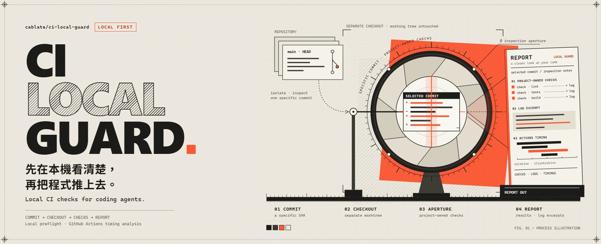

# CI Local Guard
[繁體中文](README.zh-TW.md)



**A CI failure-diagnosis and workflow-review tool for your coding AI.**

Your AI finishes a change, pushes it, and CI fails. Now what? Pasting a whole log into the conversation wastes time and context; guessing wastes a push. Guard gives your AI the shortest path to the cause: which job and step failed, which test at which file and line, and exactly which part of the log to read.

It also answers the question before it becomes an outage: after you edit a workflow, does CI now check less for the same changes? And it reads GitHub Actions timings — with flaky failures separated from real ones — so speed work goes where the wait actually is.

- **Diagnose a failed run.** `ci locate` names the failed job, step, workflow line and failing tests, and saves just that step's log section for paged reading.
- **Review a workflow change.** `ci diff` shows what runs less, more or cannot be determined after your edit; `ci check` scans the workflow statically.
- **Understand slow CI.** `ci history` separates flaky failures (passed later on the same commit) from persistent ones, follows gate jobs to the job that actually sets the wait, and prices failed runs in minutes.
- **Optional: replay a job locally before pushing.** `ci verify` / `ci replay` run the Linux jobs of a commit in local containers. Most projects do not need this to get the value above.

Guard works alongside your CI. It reads what GitHub already knows and runs locally what can run locally; GitHub Actions still covers things that need the hosted environment.

## Let your AI set it up

Give your AI this repository link and a request like this:

> Help me use https://github.com/cablate/ci-local-guard in my project. Read its README and docs, then when a CI run fails use ci locate to find the cause, and before we merge workflow changes use ci diff to check nothing is lost.

Your AI will need to read project files and run Node commands; diagnosing GitHub runs also needs a signed-in GitHub CLI (gh). No project setup or adapter is required for these commands.

## Install the CLI

You need Node 22 (>=22.13.0 <23) and Git. Clone the tool into its own directory:

```sh
git clone --branch v0.3.0 --depth 1 https://github.com/cablate/ci-local-guard.git
node ci-local-guard/cli.mjs --version
node ci-local-guard/cli.mjs --help
```

The version command should print 0.3.0. You can share this installation across projects.

No npm account is needed. Downloads are also available in [GitHub Releases](https://github.com/cablate/ci-local-guard/releases). This tool is distributed through GitHub, not the npm registry.

Want to try it without setting up a project? Follow the [offline example](docs/reference.md#offline-example) to analyze a small sample.

### Using Claude Code?

Install the optional plugin instead:

```sh
claude plugin marketplace add cablate/ci-local-guard
claude plugin install ci-local-guard@ci-local-guard-marketplace
```

Restart Claude Code and use /ci-local-guard:ci. The plugin bundles the same CLI and adds instructions for Claude; Node and Git are still required.

## AI entry point

Read the [command reference](docs/reference.md) first. The usual workflow:

1. **A GitHub run failed.** `ci locate` finds the runs for your HEAD commit (or one run with `--run <id>`), names the failed job, step, workflow line and failing tests with file and line, and saves that step's log for `read-evidence` paged reading.
2. **You changed a workflow.** `ci diff` compares two commits for the same events and files: what runs less, more or cannot be determined. `ci check` adds a static scan (actionlint, zizmor).
3. **CI is slow.** `ci history` shows the wait-setting job (gate jobs traced to what they wait on), separates flaky failures from persistent ones, and prices failed runs. `ci optimize` turns that into candidate findings with evidence.
4. **Starting on an unknown repository.** `ci discover` lists what CI runs, which jobs could replay locally and which commands to use.

### Experimental: project adapters and push hooks

The preflight path — a project-owned adapter script, a `.ci-local-guard.json` descriptor, receipts, and the `install-hook` pre-push gate — is **experimental**. It predates the `ci` commands, needs project setup, and its hook does not chain with hooks you already have (installing refuses rather than silently disable them; `--force` overrides). Do not build on it unless you specifically want commit-gated project checks:

```sh
node "<tool-directory>/cli.mjs" doctor --check --repo "<consumer-path>" --summary
node "<tool-directory>/cli.mjs" preflight --repo "<consumer-path>" --base <base> --head <commit> --summary
```

The [reference](docs/reference.md) documents the full contract.

## Optional: replay a job locally before pushing

These commands read your GitHub workflows directly and need no adapter. Replaying jobs needs [act](https://github.com/nektos/act) 0.2.89 and Docker with Linux containers.

```sh
node "<tool-directory>/cli.mjs" ci verify --repo "<project>" --summary
node "<tool-directory>/cli.mjs" ci replay --repo "<project>" --workflow .github/workflows/ci.yml --job test --summary
```

verify takes the commit you are about to push, works out which workflows it triggers, and runs the Linux jobs in local containers. It reports what is expected to fail, with the failing step, command and log location, and what still needs GitHub, such as Windows jobs or jobs that use secrets. replay runs a single job on demand; on a Windows host, verify also lists the commands of matching hosted-only legs so your AI can run them in the working tree. Details are in the [reference](docs/reference.md#understand-check-and-replay-ci).

## Investigate slow CI

With GitHub CLI (gh) already signed in:

```sh
node "<tool-directory>/cli.mjs" ci history --repo "<project>" --workflow ci.yml --summary
node "<tool-directory>/cli.mjs" ci optimize --repo "<project>" --summary
```

history separates flaky failures (they passed later on the same commit — nothing a pre-push check could catch) from persistent ones, and its `--reproduce` replays only the persistent commits, skipping flakes. The offline collectors (`collect-runs`, `inspect-runs`, `audit-runs`, `compare-runs`) analyze saved exports. The aim is to remove unnecessary work, not necessary tests.

## Field battery

[quality/field-battery/](quality/field-battery/README.md) stress-tests Guard's own CLI with data-driven scenarios: offline edges, gh read-only queries, discovery deadline pressure, and act/Docker replay. CI runs the offline battery on every push and pull request, with this repository itself as the sample repo. Run the other three by hand from the repo root: `node quality/field-battery/run-gh.mjs` (needs a signed-in GitHub CLI), `node quality/field-battery/run-flake.mjs`, and `node quality/field-battery/run-replay.mjs` (needs Docker and act).

## More help

- [Setup, report formats and examples](docs/reference.md)
- [Updating and uninstalling](docs/reference.md#updating-disabling-and-removing)
- [Settings and troubleshooting](docs/reference.md#data-permissions-and-settings)
- [What's changed](CHANGELOG.md) · [Contributing](https://github.com/cablate/ci-local-guard/blob/main/CONTRIBUTING.md) · [MIT license](LICENSE)

Guard runs your project's scripts with your local permissions, so use it with projects you trust. It has no built-in telemetry. Review logs before sharing them; security concerns can be reported [privately](https://github.com/cablate/ci-local-guard/security/advisories/new).

<details>
<summary>PRINCIPLE — how we decide what belongs in this tool</summary>

1. Help improve both local development and CI, rather than just moving work between them.
2. Keep the checks that protect the project, even when making them faster.
3. Reuse the project's rules instead of creating a competing set.
4. Test the intended commit, separately from unfinished edits.
5. Remove repeated or unnecessary work before adding caching or parallelism.
6. Reuse results only when the inputs truly match. Guard currently runs fresh checks every time.
7. Measure waiting time and total job time separately; neither is a billing calculation.
8. Make failures useful: show what ran, what failed and where to look next.
9. Keep investigation, proposals and changes separate, with approval where needed.
10. Keep the tool small. Add features for real needs, not imagined integrations.

</details>

## Project status

[v0.3.0](https://github.com/cablate/ci-local-guard/releases/tag/v0.3.0) is an experimental release. [Windows and Ubuntu tests](https://github.com/cablate/ci-local-guard/actions/runs/37925557268) pass, and a field battery of real-project scenarios runs in CI on every push. The release archive and Claude Code 2.1.293 plugin installation, upgrade and removal were last tested on v0.1.1. macOS, arm64, Claude Desktop and WSL have not been tested.

Guard's focus is failure diagnosis (ci locate), workflow review (ci diff, ci check) and timing analysis (ci history, ci optimize); local replay (ci verify, ci replay) is optional, and the project-adapter/push-hook path is experimental. Four rounds of field reports from a real 12-workflow project shaped this: what actually helped is now what leads.

We use Guard to check this repository too. Replay has been tested on Windows with Docker Desktop (Linux containers), and with Guard itself running in a Linux container against the same Docker engine, including Ctrl-C cleanup. A native Linux machine and macOS have not been tested.

Found something confusing or broken? [Open an issue](https://github.com/cablate/ci-local-guard/issues) with your tool version, operating system and a small example.
